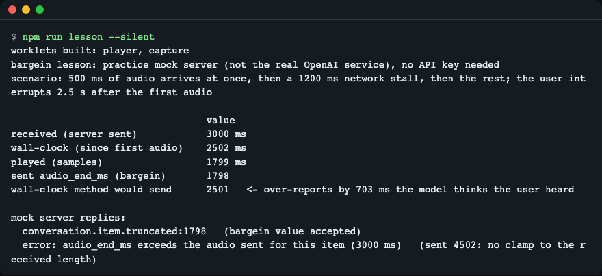
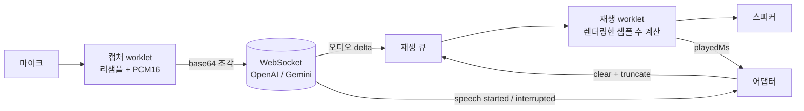
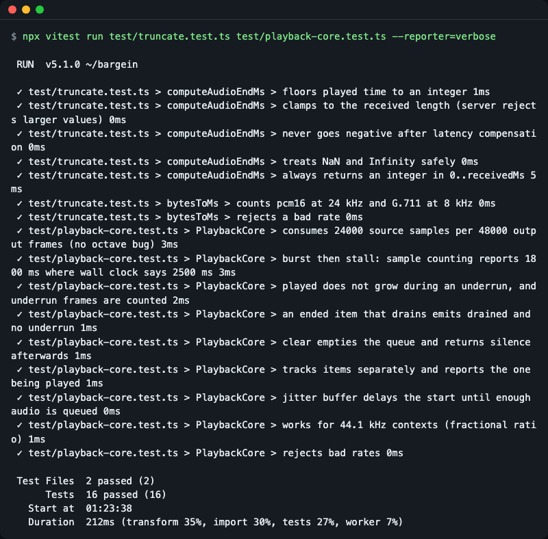

# bargein

[English](README.md) | **한국어**

실시간 음성 모델(OpenAI Realtime, Gemini Live)과 WebSocket 으로 대화하는 브라우저용 라이브러리입니다(런타임 의존성 0). 마이크를 16 kHz / 24 kHz PCM16 조각으로 캡처하고, 모델의 24 kHz 응답을 끊김 없이 재생하며, 사용자가 말을 끊으면("barge-in") 큐를 비우고 **실제로 들린 재생 위치**를 알려 줍니다. 위치는 벽시계 시간이 아니라 AudioWorklet 이 센 샘플 수로 계산합니다.



*`npm run lesson` 을 연습용 목(mock) 서버에 실행한 결과: 벽시계 방식은 약 700 ms 를 과다 보고합니다.*

## 설치

```bash
npm install bargein
```

- 브라우저: AudioWorklet(ES 모듈)을 지원하는 브라우저. Node 22.12+ 는 빌드·테스트에만 필요합니다.
- 런타임 의존성: 0개.
- 저장소를 받아 lesson·데모·테스트를 돌리려면: `git clone https://github.com/LeeGyeongPil/bargein && cd bargein && npm install`. Node 가 없으면 `brew install node`(macOS)나 패키지 관리자로 설치하세요. 최소 리눅스 이미지에는 `git`, `ca-certificates` 도 필요합니다.

## 빠르게 시작하기

핵심은 어디서나 돌아가는 일반 함수입니다. 아래는 `conversation.item.truncate` 로 보낼 `audio_end_ms` 를 정합니다.

```js
import { computeAudioEndMs, bytesToMs } from 'bargein';

const receivedMs = bytesToMs(144000, 'pcm16'); // 24 kHz PCM16 144000 바이트
const playedMs = 1799.4; // AudioWorklet 이 실제로 렌더링한 길이
console.log('received:', receivedMs);
console.log('audio_end_ms:', computeAudioEndMs({ playedMs, receivedMs }));
console.log('clamped:', computeAudioEndMs({ playedMs: 5000, receivedMs: 1000 }));
```

```text
received: 3000
audio_end_ms: 1799
clamped: 1000
```

결과는 항상 0 이상, 서버가 보낸 길이 이하의 정수입니다. 실제 API 가 요구하는 조건입니다.

API 키 없이 문제 전체를 보려면 lesson 을 실행하세요(레포를 clone 한 곳에서 실행합니다. npm 패키지에는 목 서버가 들어 있지 않습니다). 로컬 연습용 목 서버(실제 서비스 아님)가 500 ms 분량 오디오를 한꺼번에 보내고, 네트워크를 1.2초 멈춘 뒤, 중간에 끼어듭니다.

```bash
npm run lesson
```

```text
worklets built: player, capture
bargein lesson: practice mock server (not the real OpenAI service), no API key needed
scenario: 500 ms of audio arrives at once, then a 1200 ms network stall, then the rest; the user interrupts 2.5 s after the first audio

                                  value
received (server sent)            3000 ms
wall-clock (since first audio)    2499 ms
played (samples)                  1799 ms
sent audio_end_ms (bargein)       1798
wall-clock method would send      2499   <- over-reports by 701 ms the model thinks the user heard

mock server replies:
  conversation.item.truncated:1798   (bargein value accepted)
  error: audio_end_ms exceeds the audio sent for this item (3000 ms)   (sent 4500: no clamp to the received length)
```

실행할 때마다 몇 ms 씩 다릅니다. lesson 출력은 영어만 지원합니다.

## 핵심 개념



1. **캡처.** 오디오 컨텍스트는 장치 샘플레이트(예: 48 kHz)를 그대로 둡니다. 캡처 worklet 이 16 kHz 또는 24 kHz 로 리샘플하고 PCM16 으로 바꿔, 기본 40 ms 단위 base64 조각을 넘겨 줍니다.
2. **끊김 없는 재생.** 모델은 24 kHz 오디오를 몰아서 보냅니다. 재생 worklet 이 큐를 두고 장치 레이트로 렌더링하며, 데이터가 바닥났을 때(underrun)만 무음을 넣고 따로 셉니다.
3. **샘플 기준 재생 위치.** worklet 이 소비한 소스 샘플 수를 셉니다. 네트워크가 멈추거나 버퍼가 앞서 있으면 벽시계 시간은 틀립니다. 아직 도착하지 않은 소리는 사용자가 듣지 못했기 때문입니다. 정체 뒤 벽시계는 약 2500 ms 라고 했지만 실제 재생은 약 1800 ms 였습니다.
4. **끼어들기.** 어댑터가 큐를 비우고, OpenAI 에서는 응답이 아직 생성 중일 때만 `response.cancel` 을 보낸 뒤 잘라낸 정수 `audio_end_ms` 로 `conversation.item.truncate` 를 보냅니다. Gemini 는 서버가 `serverContent.interrupted` 를 보내 주므로 큐만 비우고 아무것도 보내지 않습니다.

## API

`bargein`(코어), `bargein/openai`, `bargein/gemini` 에서 가져옵니다.

| 이름 | 하는 일 | 주요 인자 | 반환 |
|---|---|---|---|
| `createPlayer(ctx, opts?)` | AudioWorklet 재생기 생성 | `ctx` AudioContext; `sourceRate`(24000), `jitterMs`(0), `latencyCompensation`(`'output'`), `workletUrl`, `destination` | `Promise<Player>` |
| `player.push(itemId, audio, contentIndex?)` | PCM16(Int16Array, ArrayBuffer, base64)을 큐에 넣음 | 항목 id, 오디오 | `void` |
| `player.endItem(itemId)` | 서버가 항목 전송을 마쳤음을 알림 | 항목 id | `void` |
| `player.clear()` | 큐를 비우고 위치를 알려 줌 | 없음 | `Promise<ClearResult>`(`audioEndMs`, `playedMs`, `receivedMs`, `heardMs`, `underrunMs`, `itemId`, `contentIndex`, `ended`) |
| `player.position()` | 비우지 않고 위치만 읽음 | 없음 | `Promise<PlaybackPosition>` |
| `player.on(event, fn)` | `started`, `drained`, `underrun` 구독 | 이벤트, 콜백 | 구독 해제 함수 |
| `player.close()` | worklet 해제. 대기 중이던 `clear()`·`position()` 은 `CLOSED` 로 reject | 없음 | `Promise<void>` |
| `createCapture(ctx, source, opts)` | MediaStream·AudioNode 를 PCM16 조각으로 캡처 | `targetRate`(16000 또는 24000), `chunkMs`(40), `onChunk`, `workletUrl` | `Promise<Capture>`(`start`, `stop`, `close`) |
| `createOpenAIBargeIn({ player, send, ... })` | OpenAI Realtime 어댑터 | `outputFormat`(`pcm16`, `g711_ulaw`, `g711_alaw`), `cancelOnBargeIn`(true), `onError` | `{ handleServerEvent(ev), bargeIn() }` |
| `toOpenAIAppend(base64)` | `input_audio_buffer.append` 생성 | base64 조각 | 이벤트 객체 |
| `createGeminiBargeIn({ player, onError? })` | Gemini Live 어댑터 | player | `{ handleServerMessage(msg) }` |
| `toGeminiRealtimeInput(base64)` | `realtimeInput.audio`(16 kHz) 생성 | base64 조각 | 메시지 객체 |
| `toGeminiAudioStreamEnd()` | `realtimeInput.audioStreamEnd` 생성 | 없음 | 메시지 객체 |
| `computeAudioEndMs({ playedMs, receivedMs, latencyMs? })` | 0..receivedMs 로 잘라낸 정수 `audio_end_ms` | 재생, 수신, 지연 | `number` |
| `bytesToMs(bytes, format, rate?)` | `pcm16`, `g711_ulaw`, `g711_alaw` 바이트 수를 ms 로 | 바이트, 형식 | `number` |
| `floatToPcm16`, `pcm16ToFloat` | Float32 와 Int16 변환(32767 / -32768 로 잘림) | 배열 | 배열 |
| `encodeBase64`, `decodeBase64` | 오디오 버퍼용 base64 | 데이터 | `string` / `Uint8Array` |
| `bytesToPcm16`, `g711ToPcm16` | 리틀엔디언 바이트·G.711 을 Int16 으로 | 바이트 | `Int16Array` |
| `StreamResampler` | 스트리밍 선형 리샘플러. 조각을 어떻게 나눠도 결과가 같음 | 입력 레이트, 출력 레이트 | 클래스 |
| `PlaybackCore`, `CaptureCore` | worklet 뒤의 DOM 없는 로직(테스트·브라우저 외 Web Audio 용) | | 클래스 |
| `BargeinError` | `code` 가 있는 오류: `WORKLET_LOAD_FAILED`, `CONTEXT_SUSPENDED`, `BAD_AUDIO`, `CLOSED` | | 클래스 |

콘텐츠 보안 정책(CSP)이 `blob:` 을 막는 페이지는 `dist/worklets/player.js`, `capture.js` 를 직접 서빙하고 `workletUrl` 로 넘기세요.

## 사용 예

OpenAI Realtime([examples/openai-minimal.ts](examples/openai-minimal.ts)). API 키가 서버에만 있도록 직접 만든 중계 서버를 거쳐 연결하세요.

```ts
import { createCapture, createPlayer } from 'bargein';
import { createOpenAIBargeIn, toOpenAIAppend } from 'bargein/openai';

const ctx = new AudioContext(); // 클릭 핸들러 안에서 호출
const ws = new WebSocket(relayUrl);
const player = await createPlayer(ctx); // 24 kHz PCM16 출력
const bargein = createOpenAIBargeIn({ player, send: (ev) => ws.send(JSON.stringify(ev)) });
ws.onmessage = (m) => bargein.handleServerEvent(JSON.parse(m.data)); // 오디오, cancel, truncate 를 여기서 처리

const stream = await navigator.mediaDevices.getUserMedia({ audio: { echoCancellation: true, noiseSuppression: true } });
const capture = await createCapture(ctx, stream, {
  targetRate: 24000,
  onChunk: (c) => ws.readyState === WebSocket.OPEN && ws.send(JSON.stringify(toOpenAIAppend(c.base64))),
});
capture.start();
```

Gemini Live([examples/gemini-minimal.ts](examples/gemini-minimal.ts)): `createGeminiBargeIn({ player })`, `targetRate: 16000`, `toGeminiRealtimeInput` 만 바꾸면 같습니다. Live API 프레임은 바이너리일 수 있으니 `JSON.parse` 전에 `await blob.text()` 로 읽으세요.

브라우저 데모 페이지는 영어·한국어를 지원합니다(`?lang=ko`). 연습용 목 서버에 연결해, 끼어드는 동안 받은 길이·재생된 길이·벽시계 막대를 보여 줍니다.

```bash
npm run demo
```

출력된 `http://127.0.0.1:5173/` 를 열고 연결, 응답 시작, 끼어들기 순서로 누르세요. 실제 마이크 캡처와 실제 모델은 브라우저와 직접 만든 중계 서버가 필요하며, 데모 페이지는 API 키를 쓰지 않습니다.

## 언제 쓰나

- 이럴 때: 브라우저 앱이 OpenAI Realtime 이나 Gemini Live 와 WebSocket 으로 통신하고, 예제 콘솔에서 오디오 코드를 복사하는 대신 끊김 없는 재생과 실제 재생 기준 truncate 값이 필요할 때.
- WebRTC 전송이면 필요 없음: 재생을 브라우저와 서버가 관리합니다.
- 이럴 땐 다른 도구: WebRTC 전송이나 완성된 에이전트 프레임워크는 [OpenAI Agents SDK for TypeScript](https://github.com/openai/openai-agents-js), 읽어 볼 전체 예제 앱은 [live-api-web-console](https://github.com/google-gemini/live-api-web-console).

한계: 리샘플러는 저역통과 없는 선형 방식이라 48 kHz 에서 16 kHz 로 낮출 때 고주파가 겹칠 수 있고, `outputLatency` 는 브라우저에서 읽습니다(Node 테스트 환경에서는 0). 개발 중 데모 페이지와 마이크 경로는 실제 브라우저에서 확인하지 못했고, 오디오 경로는 Node 용 Web Audio 구현으로 검증했습니다. 서버측 키 중계와 React 훅은 아직 없습니다.

전사 한계: `conversation.item.truncate` 는 모델이 들은 것으로 기억하는 내용을 바로잡지만, 잘린 항목의 서버 전사(`response.output_audio_transcript.done`)에는 사용자가 듣지 못한 텍스트가 남을 수 있습니다. [2024-11 부터 열려 있는 알려진 이슈](https://community.openai.com/t/realtime-api-interruptions-dont-properly-trim-the-transcript/1000703)입니다(2026-11-17 확인). 화면 자막은 직접 잘라 쓰세요(예: 재생된 비율만큼).

## 자주 겪는 문제

- **소리가 안 나거나 `CONTEXT_SUSPENDED`**: 브라우저는 사용자 동작 뒤에만 오디오를 시작합니다. `AudioContext` 를 클릭 핸들러 안에서 만드세요.
- **`WORKLET_LOAD_FAILED`**: 엄격한 CSP 가 `blob:` 을 막은 경우입니다. `dist/worklets/*.js` 를 서빙하고 `workletUrl` 을 넘기세요.
- **서버가 `audio_end_ms` 를 거부**: 서버가 만든 오디오보다 큰 값입니다. 잘라 주는 `computeAudioEndMs` 나 `player.clear().audioEndMs` 를 쓰세요.
- **목소리가 한 옥타브 높거나 낮음**: 버퍼 샘플레이트가 데이터와 다릅니다. 올바른 `sourceRate`(24000, G.711 은 8000)로 플레이어를 만드세요. 데모 페이지에 "옥타브 버그 확인"이 있습니다.
- **Firefox 에서 마이크가 샘플레이트 불일치 오류**: `new AudioContext({ sampleRate: 24000 })` 로 강제하지 마세요. 기기 레이트를 두면 bargein 이 worklet 안에서 리샘플합니다.
- **`npm run lesson` 수치가 몇 ms 다름**: 실제 렌더 스레드를 쓰기 때문에 숫자가 정확히 반복되지 않습니다.
- **포트 8787 `EADDRINUSE`**: 다른 프로세스가 목 서버 포트를 쓰고 있습니다. `BARGEIN_MOCK_PORT` 를 빈 포트로 바꿔 다시 실행하세요. 데모 페이지는 `BARGEIN_MOCK_PORT` 를 자동으로 따라가며, 목 서버를 따로 띄웠다면 URL 입력란을 그 주소로 바꾸세요.

## 버전·호환성

- [유의적 버전(SemVer)](https://semver.org/lang/ko/)을 따릅니다. 0.x 동안은 마이너 버전에서 API 가 바뀔 수 있고, 바뀌면 [CHANGELOG.md](CHANGELOG.md)에 적습니다.
- Node 26.13.0, npm 11.20.0 에서 확인했고(지원 선언: Node 22.12+), TypeScript 7.0.2, Vitest 5.1.0, Vite 8.3.8, node-web-audio-api 2.2.0 을 썼습니다.

## 개발·기여

```bash
npm test            # 테스트 72개, 파일 10개
npm run typecheck
npm run build
npm run smoke:pack  # 묶은 tarball 을 설치해 모든 진입점을 import
npm run build:demo
```



*값 잘라내기와 재생 샘플 시뮬레이션 테스트 이름(자세히 보기).*

worklet 소스를 고치면 `npm run build:worklets` 를 실행하세요(생성된 인라인 소스는 커밋합니다).

## 라이선스

MIT.
