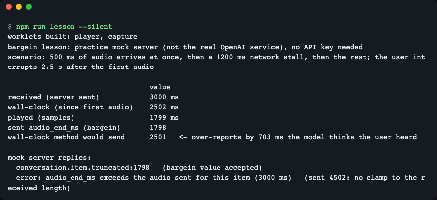
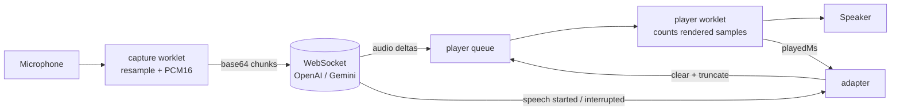
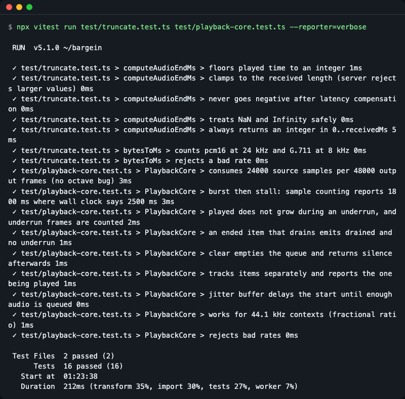

# bargein

**English** | [한국어](README.ko.md)

A zero-dependency browser library for talking to realtime voice models (OpenAI Realtime, Gemini Live) over WebSocket. It captures the microphone as 16 kHz / 24 kHz PCM16 chunks, plays the model's 24 kHz reply without gaps, and when the user interrupts ("barge-in") it clears the queue and reports the playback position that was really heard, counted in samples by an AudioWorklet instead of by wall-clock time.



*`npm run lesson` against the practice mock server: the wall-clock method over-reports by about 700 ms.*

## Install

```bash
npm install bargein
```

- Browser: any browser with AudioWorklet (ES modules). Node 22.12+ is only needed to build and test.
- Runtime dependencies: 0.
- To work from a clone (lesson, demo, tests): `git clone https://github.com/LeeGyeongPil/bargein && cd bargein && npm install`. If you do not have Node: `brew install node` (macOS) or your package manager; minimal Linux images also need `git` and `ca-certificates`.

## Quick start

The core is plain functions you can run anywhere. This one decides the `audio_end_ms` to send in `conversation.item.truncate`:

```js
import { computeAudioEndMs, bytesToMs } from 'bargein';

const receivedMs = bytesToMs(144000, 'pcm16'); // 144000 bytes of 24 kHz PCM16
const playedMs = 1799.4; // what the AudioWorklet really rendered
console.log('received:', receivedMs);
console.log('audio_end_ms:', computeAudioEndMs({ playedMs, receivedMs }));
console.log('clamped:', computeAudioEndMs({ playedMs: 5000, receivedMs: 1000 }));
```

```text
received: 3000
audio_end_ms: 1799
clamped: 1000
```

The result is always an integer between 0 and the audio the server has sent, which the real API requires.

To see the whole problem end to end without any API key, run the lesson (from a clone of the repo; the npm package does not ship the mock server). It starts a local practice mock server (not the real service), streams 500 ms of audio at once, stalls the network for 1.2 s, and interrupts:

```bash
npm run lesson
```

```text
worklets built: player, capture
bargein lesson: practice mock server (not the real OpenAI service), no API key needed
scenario: 500 ms of audio arrives at once, then a 1200 ms network stall, then the rest; the user interrupts 2.5 s after the first audio

                                  value
received (server sent)            3000 ms
wall-clock (since first audio)    2499 ms
played (samples)                  1799 ms
sent audio_end_ms (bargein)       1798
wall-clock method would send      2499   <- over-reports by 701 ms the model thinks the user heard

mock server replies:
  conversation.item.truncated:1798   (bargein value accepted)
  error: audio_end_ms exceeds the audio sent for this item (3000 ms)   (sent 4500: no clamp to the received length)
```

Values vary by a few milliseconds per run. The lesson CLI prints English only.

## Core concepts



1. **Capture.** The audio context keeps the device rate (for example 48 kHz). The capture worklet resamples to 16 kHz or 24 kHz, converts to PCM16, and hands you base64 chunks (40 ms by default).
2. **Gap-free playback.** The model sends 24 kHz audio in bursts. A player worklet keeps a queue and renders it at the device rate; silence is inserted only when data runs out (an underrun), and counted separately.
3. **Played position by samples.** The worklet counts source samples it consumed. Wall-clock time is wrong whenever the network stalls or the buffer is ahead, because the user did not hear audio that had not arrived. After a stall, wall-clock claimed about 2500 ms while about 1800 ms was played.
4. **Barge-in.** On interruption the adapter clears the queue and, for OpenAI, sends `response.cancel` (only while a response is still generating) then `conversation.item.truncate` with the clamped integer `audio_end_ms`. Gemini sends `serverContent.interrupted`, so the adapter only clears the queue and sends nothing back.

## API

Import from `bargein` (core), `bargein/openai`, and `bargein/gemini`.

| Name | What it does | Main arguments | Returns |
|---|---|---|---|
| `createPlayer(ctx, opts?)` | Creates the AudioWorklet player | `ctx` AudioContext; `sourceRate` (24000), `jitterMs` (0), `latencyCompensation` (`'output'`), `workletUrl`, `destination` | `Promise<Player>` |
| `player.push(itemId, audio, contentIndex?)` | Queues PCM16 (Int16Array, ArrayBuffer or base64) | item id, audio | `void` |
| `player.endItem(itemId)` | Marks the item as fully sent by the server | item id | `void` |
| `player.clear()` | Drops queued audio and reports the position | none | `Promise<ClearResult>` (`audioEndMs`, `playedMs`, `receivedMs`, `heardMs`, `underrunMs`, `itemId`, `contentIndex`, `ended`) |
| `player.position()` | Reads the position without clearing | none | `Promise<PlaybackPosition>` |
| `player.on(event, fn)` | Subscribes to `started`, `drained`, `underrun` | event, callback | unsubscribe function |
| `player.close()` | Releases the worklet; a `clear()` or `position()` still waiting is rejected with `CLOSED` | none | `Promise<void>` |
| `createCapture(ctx, source, opts)` | Captures a MediaStream or AudioNode as PCM16 chunks | `targetRate` (16000 or 24000), `chunkMs` (40), `onChunk`, `workletUrl` | `Promise<Capture>` (`start`, `stop`, `close`) |
| `createOpenAIBargeIn({ player, send, ... })` | OpenAI Realtime adapter | `outputFormat` (`pcm16`, `g711_ulaw`, `g711_alaw`), `cancelOnBargeIn` (true), `onError` | `{ handleServerEvent(ev), bargeIn() }` |
| `toOpenAIAppend(base64)` | Builds `input_audio_buffer.append` | base64 chunk | event object |
| `createGeminiBargeIn({ player, onError? })` | Gemini Live adapter | player | `{ handleServerMessage(msg) }` |
| `toGeminiRealtimeInput(base64)` | Builds `realtimeInput.audio` (16 kHz) | base64 chunk | message object |
| `toGeminiAudioStreamEnd()` | Builds `realtimeInput.audioStreamEnd` | none | message object |
| `computeAudioEndMs({ playedMs, receivedMs, latencyMs? })` | Integer `audio_end_ms`, clamped to 0..receivedMs | played, received, latency | `number` |
| `bytesToMs(bytes, format, rate?)` | Byte count to milliseconds for `pcm16`, `g711_ulaw`, `g711_alaw` | bytes, format | `number` |
| `floatToPcm16`, `pcm16ToFloat` | Float32 and Int16 conversion (clips to 32767 / -32768) | arrays | arrays |
| `encodeBase64`, `decodeBase64` | Base64 for audio buffers | data | `string` / `Uint8Array` |
| `bytesToPcm16`, `g711ToPcm16` | Little-endian bytes or G.711 to Int16 | bytes | `Int16Array` |
| `StreamResampler` | Streaming linear resampler; chunking never changes the output | from rate, to rate | class |
| `PlaybackCore`, `CaptureCore` | DOM-free logic behind the worklets (for tests and non-browser Web Audio) | | classes |
| `BargeinError` | Error with `code`: `WORKLET_LOAD_FAILED`, `CONTEXT_SUSPENDED`, `BAD_AUDIO`, `CLOSED` | | class |

Pages whose Content Security Policy blocks `blob:` URLs can serve `dist/worklets/player.js` and `capture.js` and pass `workletUrl`.

## Usage examples

OpenAI Realtime ([examples/openai-minimal.ts](examples/openai-minimal.ts)). Connect through your own relay server so the API key stays on the server:

```ts
import { createCapture, createPlayer } from 'bargein';
import { createOpenAIBargeIn, toOpenAIAppend } from 'bargein/openai';

const ctx = new AudioContext(); // call from a click handler
const ws = new WebSocket(relayUrl);
const player = await createPlayer(ctx); // 24 kHz PCM16 output
const bargein = createOpenAIBargeIn({ player, send: (ev) => ws.send(JSON.stringify(ev)) });
ws.onmessage = (m) => bargein.handleServerEvent(JSON.parse(m.data)); // audio, cancel and truncate handled here

const stream = await navigator.mediaDevices.getUserMedia({ audio: { echoCancellation: true, noiseSuppression: true } });
const capture = await createCapture(ctx, stream, {
  targetRate: 24000,
  onChunk: (c) => ws.readyState === WebSocket.OPEN && ws.send(JSON.stringify(toOpenAIAppend(c.base64))),
});
capture.start();
```

Gemini Live ([examples/gemini-minimal.ts](examples/gemini-minimal.ts)): same idea with `createGeminiBargeIn({ player })`, `targetRate: 16000`, and `toGeminiRealtimeInput`. Live API frames can be binary, so read them with `await blob.text()` before `JSON.parse`.

Browser demo page, bilingual (English / Korean, `?lang=ko`). It connects to the practice mock server and shows received, played and wall-clock bars while you interrupt:

```bash
npm run demo
```

Then open the printed `http://127.0.0.1:5173/`, click Connect, Start response, and Interrupt. Real microphone capture and a real model need a browser and your own relay; the demo page does not use an API key.

## When to use it

- Good fit: your browser app talks to OpenAI Realtime or Gemini Live over WebSocket and you want gap-free playback and a truncate value based on what was actually played, without copying audio code out of an example console.
- Not needed with WebRTC transport: the browser and server manage playback there.
- Other tools: WebRTC transport or a ready-made agent framework, see the [OpenAI Agents SDK for TypeScript](https://github.com/openai/openai-agents-js); a full example app to read, see [live-api-web-console](https://github.com/google-gemini/live-api-web-console).

Limits: the resampler is linear without a low-pass filter (48 kHz to 16 kHz may alias high frequencies), and `outputLatency` is read from the browser (0 in the Node test environment). The demo page and microphone path were not exercised in a real browser during development; the audio path was verified through a Node Web Audio implementation. A server-side key relay and a React hook are not included yet.

Transcript limit: `conversation.item.truncate` fixes what the model remembers hearing, but the server transcript of the cut item (`response.output_audio_transcript.done`) can still contain text the user never heard. This is a known [open issue since 2024-11](https://community.openai.com/t/realtime-api-interruptions-dont-properly-trim-the-transcript/1000703) (checked 2026-11-17); trim displayed captions yourself, for example by the played fraction of the item.

## Troubleshooting

- **No sound or `CONTEXT_SUSPENDED`**: browsers start audio only after a user gesture. Create the `AudioContext` inside a click handler.
- **`WORKLET_LOAD_FAILED`**: a strict Content Security Policy blocks `blob:`. Serve `dist/worklets/*.js` and pass `workletUrl`.
- **Server rejects `audio_end_ms`**: the value exceeded the audio the server generated. Use `computeAudioEndMs` or `player.clear().audioEndMs`, which clamp it.
- **Voice sounds an octave too high or low**: the buffer sample rate does not match the data. Create the player with the right `sourceRate` (24000, or 8000 for G.711). The demo page has an "octave bug check".
- **Mic fails in Firefox with a sample-rate mismatch error**: do not force `new AudioContext({ sampleRate: 24000 })`. Keep the device rate; bargein resamples inside the worklet.
- **`npm run lesson` timing differs by a few ms**: it uses a real render thread; the numbers are not exactly repeatable.
- **`EADDRINUSE` on port 8787**: another process uses the mock server port. Set `BARGEIN_MOCK_PORT` to a free port and run again. The demo page follows `BARGEIN_MOCK_PORT` automatically; if you started the mock server separately, change the URL field to its address.

## Versions and compatibility

- Follows [Semantic Versioning](https://semver.org/). During 0.x the API may change in minor versions; changes are listed in [CHANGELOG.md](CHANGELOG.md).
- Tested with Node 26.13.0 and npm 11.20.0 (declared support: Node 22.12+), TypeScript 7.0.2, Vitest 5.1.0, Vite 8.3.8, node-web-audio-api 2.2.0.

## Development

```bash
npm test            # 72 tests, 10 files
npm run typecheck
npm run build
npm run smoke:pack  # install the packed tarball and import every entry point
npm run build:demo
```



*Verbose test names for the clamp and the played-sample simulation.*

If you edit the worklet sources, run `npm run build:worklets` (the generated inline sources are committed).

## License

MIT.
